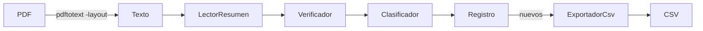

# FINANZAS — importador de Mercado Pago

Convierte el resumen de cuenta de Mercado Pago (PDF) en un CSV categorizado para importar en [Actual Budget](https://actualbudget.org/).

- Comprueba que el resumen cuadre (saldo de cada fila, saldo final, entradas y salidas). Si algo no cuadra, no importa nada.
- Ignora las reservas (Dinero reservado / retirado HOGAR, Gastos).
- Las transferencias a tu nombre y los movimientos sin regla quedan marcados "REVISAR" en las notas, para categorizarlos a mano.
- Recuerda lo ya importado: si importás el mismo resumen dos veces, no duplica.

## Requisitos
Java 21, Maven 3.9 y `pdftotext` (paquete `poppler-utils`).

## Uso
```bash
mvn package
java -jar target/finanzas.jar importar ~/Descargas/resumen.pdf
java -jar target/finanzas.jar importar ~/Descargas/resumen.pdf --salida ~/Documentos/finanzas --simular
```
Sin `--salida`, el CSV (`mercadopago_<desde>_<hasta>.csv`) queda en la carpeta del PDF. `--simular` muestra el informe sin escribir nada.

En Actual Budget: cuenta → Importar → el CSV; columnas `fecha`, `beneficiario`, `categoria`, `importe`, `notas`.

## Datos
| Qué | Dónde |
|---|---|
| Reglas de categorías (editable) | `~/.config/finanzas/reglas.json` (se crea la primera vez) |
| Movimientos ya importados | `~/.local/share/finanzas/importados.txt` |

Una regla es `{"contiene": "Carrefour", "categoria": "Supermercado"}`: si la descripción la contiene (sin importar mayúsculas ni tildes), va a esa categoría. Gana la primera que coincide.

## Tests
`mvn test`. Usan un resumen inventado (`src/test/.../Muestra.java`); ningún dato real va al repo.

## Cómo está hecho

Programado por qwen y Gemma (LM Studio) a partir de tareas de Claude: ver `docs/llm/README.md`.
